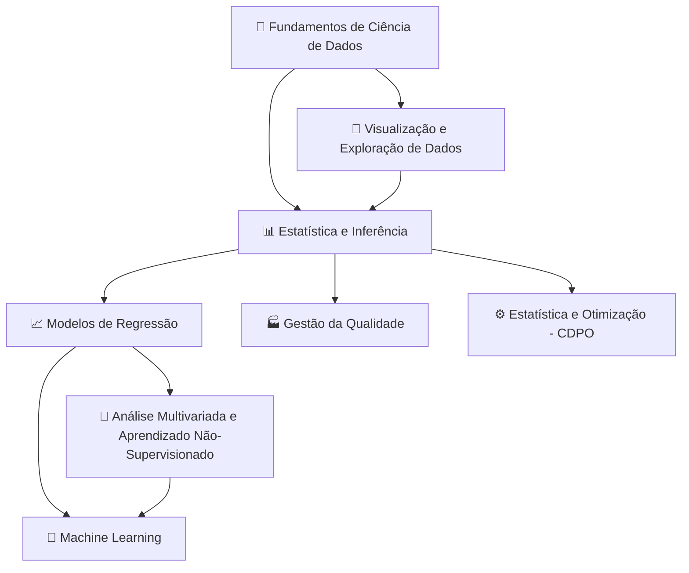

<h1 align="center">🎓 Ciência de Dados com a Profa. Cibele Russo</h1>
<p align="center"><b>Trilhas de estudo gratuitas, didáticas e organizadas por matéria, a partir das aulas do canal <a href="https://www.youtube.com/@CibeleRussoUSP">@CibeleRussoUSP</a></b></p>

<div align="center">

     

</div>

> [!NOTE]
> ✅ **Publicação autorizada pela Profa. Cibele Russo** (ICMC/USP) em 15/10/2026. Material público e gratuito, para estudo.

## 🙏 Créditos

> **Todo o conteúdo original é da Profa. Dra. Cibele Russo (ICMC/USP)**, publicado no canal [@CibeleRussoUSP](https://www.youtube.com/@CibeleRussoUSP). Este material é um **derivado de estudo**, gerado com auxílio do **Google NotebookLM** a partir das aulas, e pode conter imprecisões: na dúvida, vale sempre o vídeo original.

- 👩‍🏫 **Autora das aulas:** Profa. Dra. Cibele Russo — Instituto de Ciências Matemáticas e de Computação (ICMC), Universidade de São Paulo (USP)
- 📺 **Canal:** [youtube.com/@CibeleRussoUSP](https://www.youtube.com/@CibeleRussoUSP)
- 🤖 **Ferramenta:** os guias, trilhas e slides foram gerados com o [Google NotebookLM](https://notebooklm.google.com/) usando as aulas como fontes; aqui eles foram apenas formatados (Markdown + fórmulas LaTeX), sem acréscimo de conteúdo.

## 🗺️ Mapa de estudo

Uma sugestão de ordem (siga as setas; os ramos podem ser feitos em paralelo):



## 📚 Matérias

| | Matéria | Vídeos | Do que trata | Material |
|---|---|:-:|---|---|
| 📊 | [Estatística e Inferência](materias/estatistica-e-inferencia/README.md) | 49 | Exploração de dados, probabilidade, estimação, intervalos e testes de hipóteses | [aulas](materias/estatistica-e-inferencia/aulas.md) · [vídeos](materias/estatistica-e-inferencia/videos.md) · [slides](materias/estatistica-e-inferencia/slides.pdf) |
| 🧭 | [Análise Multivariada e Aprendizado Não-Supervisionado](materias/analise-multivariada/README.md) | 36 | Normal multivariada, Hotelling, MANOVA, PCA, clustering, LDA | [aulas](materias/analise-multivariada/aulas.md) · [vídeos](materias/analise-multivariada/videos.md) · [slides](materias/analise-multivariada/slides.pdf) |
| ⚙️ | [Estatística e Otimização (CDPO)](materias/estatistica-e-otimizacao-cdpo/README.md) | 8 | Estatística e otimização para ciência de dados e pesquisa operacional | [aulas](materias/estatistica-e-otimizacao-cdpo/aulas.md) · [vídeos](materias/estatistica-e-otimizacao-cdpo/videos.md) · [slides](materias/estatistica-e-otimizacao-cdpo/slides.pdf) |
| 🐍 | [Fundamentos de Ciência de Dados](materias/fundamentos-de-ciencia-de-dados/README.md) | 19 | Método científico, Python, NumPy/Pandas, EDA, KNN, árvores, validação | [aulas](materias/fundamentos-de-ciencia-de-dados/aulas.md) · [vídeos](materias/fundamentos-de-ciencia-de-dados/videos.md) · [slides](materias/fundamentos-de-ciencia-de-dados/slides.pdf) |
| 🏭 | [Gestão da Qualidade](materias/gestao-da-qualidade/README.md) | 37 | Controle estatístico de processos (CEP), gráficos de controle, capacidade | [aulas](materias/gestao-da-qualidade/aulas.md) · [vídeos](materias/gestao-da-qualidade/videos.md) · [slides](materias/gestao-da-qualidade/slides.pdf) |
| 🤖 | [Machine Learning (Aprendizado de Máquina Estatístico)](materias/machine-learning/README.md) | 11 | Classificação, métricas, ROC, KNN, logística, Naive Bayes, redes neurais | [aulas](materias/machine-learning/aulas.md) · [vídeos](materias/machine-learning/videos.md) · [slides](materias/machine-learning/slides.pdf) |
| 📈 | [Modelos de Regressão](materias/modelos-de-regressao/README.md) | 34 | Regressão linear simples e múltipla, modelo linear geral, ANOVA, MLG | [aulas](materias/modelos-de-regressao/aulas.md) · [vídeos](materias/modelos-de-regressao/videos.md) · [slides](materias/modelos-de-regressao/slides.pdf) |
| 🎨 | [Visualização e Exploração de Dados](materias/visualizacao-e-exploracao-de-dados/README.md) | 35 | Gráficos em R e Python, correlação, Curva de Lorenz, EDA | [aulas](materias/visualizacao-e-exploracao-de-dados/aulas.md) · [vídeos](materias/visualizacao-e-exploracao-de-dados/videos.md) · [slides](materias/visualizacao-e-exploracao-de-dados/slides.pdf) |

Ficaram de fora das trilhas 11 vídeos de **Palestras e Eventos** (não são aulas), mas eles estão no [catálogo completo](catalogo/catalogo.md).

## 🗂️ Guia e slides por aula

Além do material por matéria, algumas aulas têm **guia de estudo e slides próprios**, uma pasta por vídeo:

- [Estatística e Inferência: por aula](materias/estatistica-e-inferencia/por-aula/README.md) (2 aulas)
- [Modelos de Regressão: por aula](materias/modelos-de-regressao/por-aula/README.md) (7 aulas)

## 🧮 Fórmulas

As fórmulas usam a sintaxe matemática nativa do GitHub, por exemplo a variância combinada:

```math
S_c^2 = \frac{(n_1 - 1)S_x^2 + (n_2 - 1)S_y^2}{n_1 + n_2 - 2}
```

## 📂 Estrutura

```text
.
├── README.md                ← você está aqui
├── LICENSE                  ← CC BY-NC-SA 4.0 (material derivado)
├── CONTRIBUTING.md
├── catalogo/                ← catálogo dos 240 vídeos do canal (CSV e Markdown)
└── materias/
    └── <materia>/
        ├── README.md        ← apresentação da trilha
        ├── aulas.md         ← aulas curtas e didáticas
        ├── videos.md        ← vídeos-fonte com links
        ├── slides.pdf       ← slides do NotebookLM
        ├── por-aula/        ← guia e slides de cada aula (quando existir)
        └── imagens/         ← prévias dos slides
```

## 🚀 Como estudar

1. Escolha uma matéria no mapa acima.
2. Abra o `README.md` da matéria e siga o roteiro: **vídeo → aula → slides → exercícios**.
3. Sempre que algo parecer estranho, confira no vídeo original da professora.

## ⚖️ Licença

O material derivado (textos, trilhas, slides) está sob [CC BY-NC-SA 4.0](LICENSE). **Os vídeos e o conteúdo original pertencem à Profa. Cibele Russo** e não estão incluídos aqui, apenas linkados.
